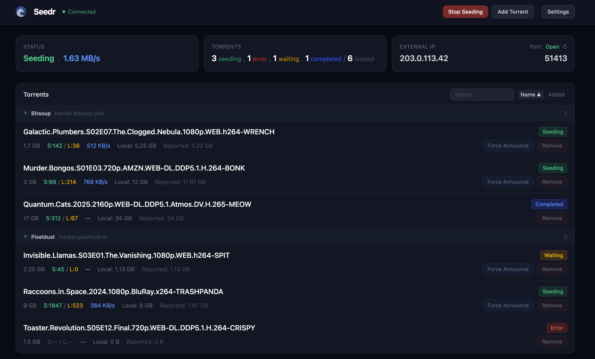

# Seedr


BitTorrent ratio master - emulates BT clients and reports simulated upload to private trackers.

Inspired by [JOAL](https://github.com/anthonyraymond/joal), built from scratch with TypeScript and Vue.js.



## How It Works

Seedr loads `.torrent` files, connects to their trackers, and announces simulated upload data - without actually downloading or uploading any content. It emulates real BitTorrent clients (qBittorrent, Deluge, Transmission, uTorrent, BitTorrent) by replicating their exact announce behavior: peer IDs, key generation, URL encoding, headers, and query parameter ordering.

**Key features:**
- 5 built-in client profiles with accurate protocol emulation
- HTTP and UDP (BEP-15) tracker support with automatic failover
- Bandwidth simulation with weighted distribution and jitter
- Real-time web dashboard with drag-and-drop torrent upload
- Opens the BitTorrent port on your router automatically (UPnP / NAT-PMP)
- Port reachability checker via [check-host.net](https://check-host.net)
- Docker support with persistent data volume
- Configurable upload ratio targets, simultaneous seed limits, and more

## Is It Safe?

Yes. But like anything in life, don't abuse it. Don't upload thousands of torrents simultaneously with unrealistic upload speeds like 2 GB/s. While trackers can't tell the difference between Seedr and qBittorrent traffic, they can detect when someone's uploading content they never actually downloaded at speeds that are physically impossible for their connection.

## Quick Start

### Docker (recommended)

```bash
mkdir seedr && cd seedr
curl -O https://raw.githubusercontent.com/rursache/Seedr/master/docker-compose.yml
docker compose up -d
```

The web UI is available at `http://localhost:8080`. Drop `.torrent` files into the `data/torrents/` directory or upload via the dashboard.

That directory is the source of truth and is rescanned on every start, so removing a torrent from the dashboard deletes its `.torrent` file. The Remove button asks for confirmation first.

### Docker manual

```bash
docker run -d \
  --name seedr \
  -p 8080:8080 \
  -p 49152:49152 \
  -v ./data:/data \
  ghcr.io/rursache/seedr:latest
```

### Native installers (.deb / .exe)

Each release also ships installers that bundle their own Node.js runtime, so nothing else needs to be installed:

- **Debian / Ubuntu** (`amd64`, `arm64`): `sudo apt install ./seedr_<version>_<arch>.deb`. Seedr is a desktop application: start **Seedr** from the applications menu (or run `seedr`) and the dashboard opens in its own window. Closing the window leaves Seedr running in the notification area: its icon offers to show the window, pause or resume seeding, open the dashboard in a browser, or quit. That needs an indicator library, which `apt` installs as a recommendation; on a desktop with no notification area (GNOME needs its AppIndicator extension, which Ubuntu enables), closing the window quits Seedr instead. Add Seedr to your desktop's startup applications to have it running after login. Data is stored in `~/.local/share/seedr` and the logs go to the journal (`journalctl -t seedr`). The window uses WebKitGTK, which `apt` pulls in as a dependency.
- **Windows 10/11 (x64)**: run `Seedr-Setup-<version>-x64.exe`, then start **Seedr** from the Start menu. It works like the Linux app: the dashboard opens in its own window, and closing the window leaves Seedr running in the notification area, whose icon menu shows the window, pauses or resumes seeding, opens the dashboard in a browser, or quits (setup asks for Seedr to be quit that way before it updates it). To have it running after sign-in, put a shortcut to `Seedr.exe` in the folder opened by `shell:startup`. Data is stored in `%LOCALAPPDATA%\Seedr\data` and the log in `%LOCALAPPDATA%\Seedr\logs\seedr.log`. The window uses the Microsoft Edge WebView2 Runtime, which comes with Windows 11 and up-to-date Windows 10 (Seedr links to the download page if it is missing). The installer adds a firewall rule for `node.exe` so the BitTorrent port is reachable.

The desktop apps also serve their dashboard on `127.0.0.1:8080` while they run (any free port if that one is taken), so it can be opened in a browser too, but never with authentication or on another interface: use Docker for a headless setup. Packaging scripts live in `packaging/`, and the `Installers` workflow builds them when a release is published.

Earlier `.deb` releases ran Seedr as a systemd service. Installing the desktop package stops and disables that service but leaves its data in `/var/lib/seedr`; with Seedr closed, copy it over with `cp -r /var/lib/seedr/. ~/.local/share/seedr/`.

Earlier Windows installers ran Seedr as a Windows service. Installing the desktop version stops and removes that service but leaves its data in `C:\ProgramData\Seedr\data`; with Seedr closed, copy it over with `Copy-Item C:\ProgramData\Seedr\data\* $env:LOCALAPPDATA\Seedr\data -Recurse` (in PowerShell). The old `seedr.env` settings file is no longer read.

### Production build

```bash
npm run build && npm start
```

To preview the UI with mock data (no real network activity):

```bash
npm run build && npm start -- --demo
```

### Local development

Requires Node.js 24+.

```bash
# Install dependencies
npm install
cd ui && npm install && cd ..

# Start the backend (hot reload)
npm run dev

# In another terminal, start the frontend dev server
cd ui && npm run dev
```

The backend runs on port `8080` with hot reload. The Vite frontend dev server proxies `/api` and `/socket.io` to the backend.

## Port Forwarding

The BitTorrent port (default `49152`) is the port that trackers and peers use to verify your client is reachable. This is the port you need to forward on your router/firewall, not the web UI port. The web UI port (`8080`) should stay local and not be exposed to the internet. If you really want to expose the WebUI port as well, make sure to enable auth!

By default Seedr asks your router to forward that port itself, over NAT-PMP and then UPnP, and renews the request while it runs. The result is shown under the external IP in the dashboard. Seedr removes the forwarding when it stops, or when you turn **Open the port on the router** off in the settings. It only works when the router has UPnP or NAT-PMP turned on and is the one connected to the internet:

- **Another router in front of yours** (an ISP box behind your own router, for instance): the dashboard says so, and the port still has to be forwarded by hand on each of them.
- **Docker**: containers on a bridge network do not see the router, so forward the port yourself, or run the container with `network_mode: host`.
- **A mapping that never expires**: some routers only accept those, and one is left behind if Seedr is killed instead of stopped. Remove it in the router's page.

## Configuration

All configuration is managed through the web UI Settings panel. Settings are persisted to `data/config.json`.

| Setting | Default | Description |
|---------|---------|-------------|
| Client Profile | first available qBittorrent profile | Which BT client to emulate |
| Port | 49152 | Listening port announced to trackers |
| Open the port on the router | on | Ask the router to forward the port (UPnP / NAT-PMP) |
| Min Upload Rate | 100 KB/s | Minimum simulated upload speed |
| Max Upload Rate | 500 KB/s | Maximum simulated upload speed |
| Max Active Torrents | -1 (all) | How many torrents to seed at once (-1 = unlimited) |
| Seed Rotation Interval | 15 | Minutes between rotating active torrents when Max Active Torrents is limited |
| Upload Ratio Target | -1 (unlimited) | Mark torrent completed after reaching this ratio; it keeps announcing but stops simulated upload (-1 = never complete by ratio) |
| Min Leechers | 1 | Only report upload when this many leechers are present |
| Min Seeders | 1 | Only report upload when this many seeders are present |
| Keep With Zero Leechers | true | Keep seeding torrents that have no leechers |
| Skip If No Peers | true | Don't report upload if no peers are connected |
| Show Filename | true | Show .torrent filename instead of torrent title in the UI |
| Theme | midnight | UI theme: `midnight`, `ember` or `amethyst` (see [Themes](#themes)) |
| Color Style | auto | Whether the theme renders light or dark, or follows the OS (auto) |

The following UI preferences are saved in the browser (localStorage) and not in `config.json`:

| Setting | Default | Description |
|---------|---------|-------------|
| Sort Field | name | Sort torrent list by name or added order |
| Sort Direction | asc | Sort direction (ascending or descending) |

## Environment Variables

| Variable | Default | Description |
|----------|---------|-------------|
| `PUID` | `1000` | User ID to run as (for volume permissions, optional) |
| `PGID` | `1000` | Group ID to run as (for volume permissions, optional) |
| `HOST` | `0.0.0.0` | Bind address for the web UI and API |
| `WEB_PORT` | `8080` | Web UI and API port |
| `USERNAME` | *(unset)* | Username for web UI authentication (optional) |
| `PASSWORD` | *(unset)* | Password for web UI authentication (optional) |
| `DATA_DIR` | `data` | Root directory for config, state, torrents, and client profiles |
| `CLIENTS_DIR` | `$DATA_DIR/clients` | Directory containing `.client` profile files |
| `TORRENTS_DIR` | `$DATA_DIR/torrents` | Directory for `.torrent` files (watched for changes) |
| `LOG_LEVEL` | `info` | Log level (debug, info, warn, error) |
| `NODE_ENV` | *(unset)* | Set to `production` to disable pretty-printed logs (the Docker image sets this) |
| `container` | *(unset)* | Set by some container runtimes; forces polling for the torrents directory watcher |

Directory variables (`DATA_DIR`, `CLIENTS_DIR`, `TORRENTS_DIR`) and the auth variables are read once at startup, so changing them requires a restart.

`container` is normally set by the container runtime itself, not by hand. Seedr also detects Docker via `/.dockerenv`; either signal switches the file watcher to polling, which is needed for bind-mounted volumes where inotify events don't propagate.


## Authentication

The web UI and API have **no authentication by default** - this is intentional since Seedr is designed to run locally or in Docker with only the BitTorrent port exposed to the internet.

To enable optional Basic Auth, set both `USERNAME` and `PASSWORD`:

```bash
# Docker Compose - uncomment the environment section in docker-compose.yml
environment:
  USERNAME: admin
  PASSWORD: changeme

# Docker manual
docker run -d --name seedr -p 8080:8080 -v ./data:/data \
  -e USERNAME=admin -e PASSWORD=changeme \
  ghcr.io/rursache/seedr:latest

# Local
USERNAME=admin PASSWORD=changeme npm start
```

When enabled, the browser will prompt for credentials when accessing the UI. All API endpoints and WebSocket connections are protected. If only one of the two variables is set, authentication remains disabled.

## Client Profiles

Seedr ships with several `.client` profile files that define how it emulates a specific BitTorrent client. Each profile controls peer ID format, key generation algorithm, URL encoding rules, HTTP headers, and query parameter ordering to match the real client's announce behavior.

Profiles are stored in the `data/clients/` directory and can be selected from the Settings panel. You can also add custom profiles by placing `.client` files in that directory.

On every start, the profiles bundled with the release are copied into `data/clients/`, so profiles added or corrected in an update reach existing installs. A bundled profile overwrites the copy on disk if it differs. Profiles the release does not ship are never touched, so custom ones are safe — but give a custom profile its own filename rather than editing a bundled one, or your changes will be replaced on the next start.

## Themes

The UI is built on semantic colour tokens rather than hardcoded colours, so a theme is a block of CSS variable overrides. Three ship, each with a full light and dark palette:

| Theme | Feel |
|-------|------|
| `midnight` | The default. Cool neutral slate with an emerald primary |
| `ember` | Warm and earthy. Warm near-black surfaces, parchment text, moss-green primary, terracotta and amber accents |
| `amethyst` | Violet and moody. Violet-tinted surfaces, lavender text, violet primary, rose and cyan accents |

Tokens are grouped into surfaces (`surface`, `surface-raised`, `surface-input`, `surface-hover`), borders (`line-subtle`, `line`, `line-strong`), text tiers (`content` through `content-ghost`), a modal `scrim`, and five accents: `primary`, `danger`, `warning`, `waiting` and `info`. Each accent has steps for solid fills, coloured text and tinted badge backgrounds.

Each theme is one file, so adding a theme does not grow a shared stylesheet:

```
ui/src/style.css                    entry, imports only
ui/src/styles/tokens.css            token vocabulary and the rules a theme follows
ui/src/styles/themes/midnight.css   the default, and the base the others override
ui/src/styles/themes/ember.css
ui/src/styles/themes/amethyst.css
```

To add one:

1. add `ui/src/styles/themes/<id>.css` with two blocks, one per colour style: `:root[data-theme="<id>"][data-color-style="dark"]` and the same with `light`
2. import it from `ui/src/style.css`
3. register it in `ui/src/themes.ts`

Name both attributes in the selector. A bare `:root[data-theme="<id>"]` has the same specificity as the shared light palette, so import order would decide which one wins and a theme's dark values could leak into light mode. `tests/ui-themes.test.ts` fails if a theme is registered without a file, is not imported, is named inconsistently, misses a colour style, or overrides a token that does not exist.

Theme and Color Style are both in the Settings panel and are stored in `config.json`. Changing either applies immediately, before saving, and reverts if the panel is closed without saving. A change saved in one browser reaches any other open browser straight away.

Color Style is separate from the theme: the theme picks the palette, Color Style decides whether it renders light or dark, with `auto` following the operating system and reacting to it live. `midnight`'s light values are also the base a theme inherits for anything it does not override, so a new theme stays legible in light mode even before it is finished.

## API

| Method | Endpoint | Description |
|--------|----------|-------------|
| `GET` | `/api/config` | Get current configuration |
| `PUT` | `/api/config` | Update configuration |
| `GET` | `/api/config/clients` | List available client profiles |
| `GET` | `/api/torrents` | List loaded torrents |
| `POST` | `/api/torrents` | Upload a .torrent file (multipart) |
| `DELETE` | `/api/torrents/:hash` | Remove a torrent |
| `POST` | `/api/torrents/:hash/announce` | Force an immediate announce |
| `POST` | `/api/control/start` | Start seeding |
| `POST` | `/api/control/stop` | Stop seeding |
| `GET` | `/api/control/status` | Get engine status |
| `POST` | `/api/control/port-check` | Check port reachability |

| `GET` | `/api/events` | Recent event log entries (`?limit=` to change the page size) |
| `DELETE` | `/api/events` | Clear the event log |
| `DELETE` | `/api/events/:id` | Dismiss a single entry |

Real-time updates are available via Socket.IO on the same port.

## Event Log

The terminal icon in the header opens the event log: announces, torrents appearing and disappearing, and the engine starting and stopping. Entries can be filtered to problems or activity, dismissed individually, or cleared all at once.

History is kept in `data/events.db`, a SQLite database using Node's built-in driver, so it survives restarts without adding a dependency. It is designed for a process that runs for months: rows are appended rather than rewriting a file, only the page being displayed is held in memory, and growth is bounded from three directions — every recorded string is clamped, rows are capped at 5000, and anything older than 30 days is dropped.

## Tests

```bash
npm test              # Run once
npm run test:watch    # Watch mode
```

## License

This project is licensed under the [MIT License](LICENSE).
